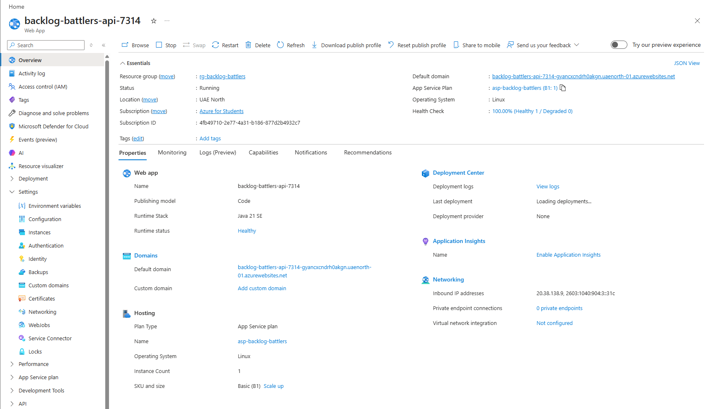
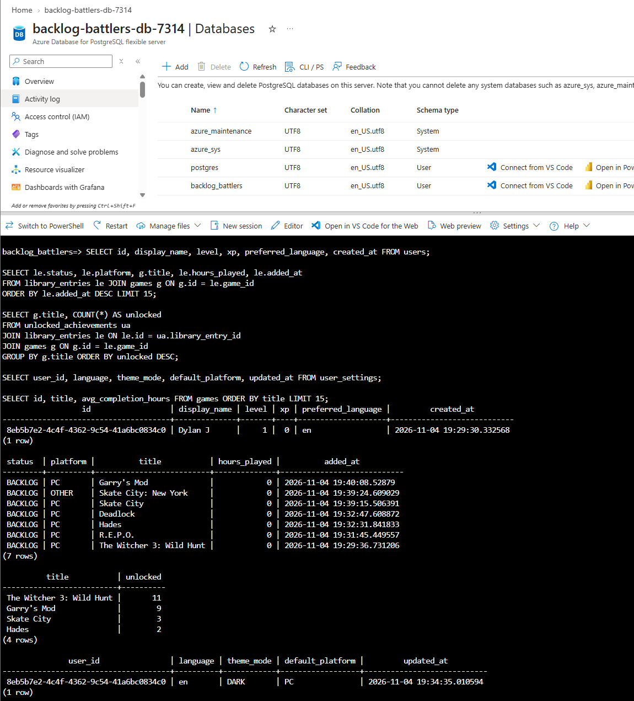
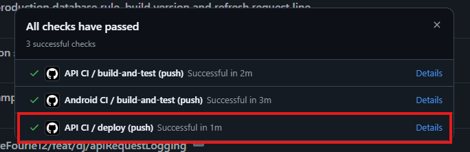
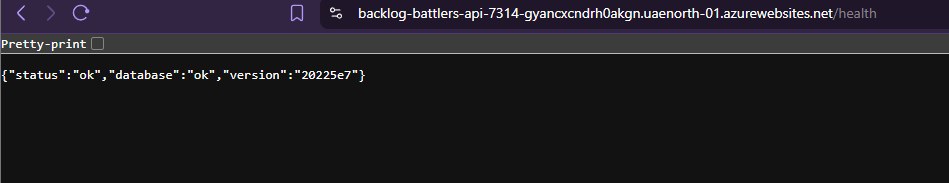
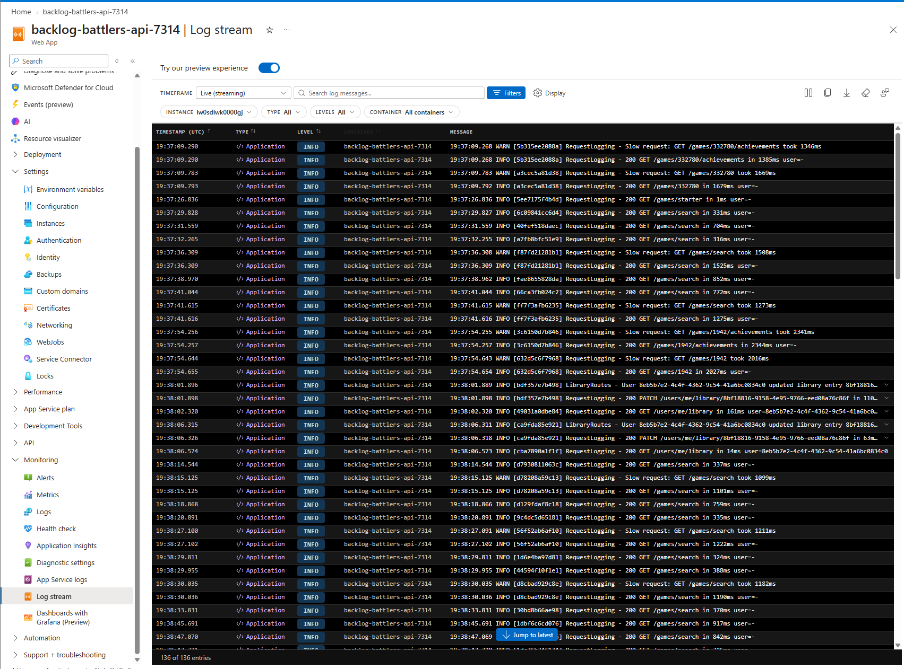

<div align="center">
  <a href="https://github.com/AndreFourie12/Backlog-Battlers">
    
  </a>

<h3 align="center">Backlog Battlers</h3>
  <p align="center">
    PROG7314 Repo for Backlog Battlers, a mobile app designed to help gamers complete unfinished games.
    <br />
    <br />
    <a href="https://github.com/AndreFourie12/Backlog-Battlers/actions/workflows/android-ci.yml">
      
    </a>
    <a href="https://github.com/AndreFourie12/Backlog-Battlers/actions/workflows/api-ci.yml">
      
    </a>
  </p>
</div>

## Team Members
<table>
  <tr>
    <td align="center"></td>
    <td>
      <b>Mihir Jagdaw</b><br/>
      Student Number: 10449392<br/>
      <a href="https://github.com/ST10449392">@ST10449392</a>
    </td>
  </tr>
  <tr>
    <td align="center"></td>
    <td>
      <b>Andre Fourie</b><br/>
      Student Number: 10438312<br/>
      <a href="https://github.com/AndreFourie12">@AndreFourie12</a>
    </td>
  </tr>
  <tr>
    <td align="center"></td>
    <td>
      <b>Dylan Jurgens</b><br/>
      Student Number: 10434135<br/>
      <a href="https://github.com/Doingle">@Doingle</a>
    </td>
  </tr>
</table>


##  Table of Contents
<ol>
  <li>
    <a href="#project-overview">Project Overview</a>
    <ul>
      <li><a href="#built-with">Built With</a></li>
    </ul>
  </li>
  <li><a href="#core-purpose-and-scope">Core Purpose and Scope</a></li>
  <li><a href="#design-consideration-and-architectural-choices">Design Consideration and Architectural Choices</a></li>
  <li><a href="#logging-and-request-tracing">Logging and Request Tracing</a></li>
  <li><a href="#hosting-and-deployment">Hosting and Deployment</a></li>
  <li>
    <a href="#comprehensive-summary">Comprehensive Summary</a>
    <ul>
      <li><a href="#implementation-of-version-control">Implementation of Version Control</a></li>
      <li><a href="#github-actions">GitHub Actions</a></li>
    </ul>
  </li>

  <li><a href="#video-demonstration">Video Demonstration</a></li>
  <li><a href="#references">References</a></li>
</ol>

## Project Overview
To see full commit history, pipeline, and tests go to -> https://github.com/AndreFourie12/Backlog-Battlers.git

### Built With
- Kotlin (Both the Android app and the REST API)
- [Ktor] (https://ktor.io) - served as the framework for the API server and it's HTTP client
- [Exposed](https://www.jetbrains.com/help/exposed/home.html) - Enables access to the SQL for the API
- [IGDB API](https://api-docs.igdb.com/) - provided the game catalogue and average time to complete a game
- [Steam Web API](https://partner.steamgames.com/doc/webapi/ISteamUserStats) - provided the achievements and their rarity
- Google Sign-In, which is verified server-side with JWT
- Azure App Service - runs the API
- Azure Database for PostgreSQL - production database
- Github Actions - CI was used for both the API and the App
<p align="right">(<a href="#readme-top">back to top</a>)</p>

## Core Purpose and Scope

Backlog Battlers' provides a rarity and time to complete-weighted scoring for it's users. Meaning that if someone were to acquire an achievement only 0.8% of players have, they will be awarded more points compared to an achievement 40% of players have. Similarly, if a user finished a game in 70 hours, whereas the average time to beat is 100 hours, that user will be awarded more points than someone who finished the same game in 95 hours. To accomplish this a REST API did most of the heavy lifting. 

The scope for this part was the Google sign in, settings, the REST API and database, game search, library management, achievement scoring and the leaderboard. More features are to come in the final POE.
<p align="right">(<a href="#readme-top">back to top</a>)</p>

## Design Consideration and Architectural Choices
**Two separate Gradle builds.** The API (`api/`) is its own Ktor project, to prevent the Android Gradle Plugin and the JVM/Kotlin toolchain from conflicting. Each of which have its own CI job.

**Authentication.** The app signs in with Google, which the API verifies the resulting ID token and issues its own short-lived JWT access token plus a longer-lived refresh token. Additionally, every endpoint that needs a signed-in user reads that token from the `Authorization: Bearer` header. If invalid, expired, or wrong-type token is rejected without leaking why and a deleted user's still-valid token is also rejected.

**Scoring.** Achievement points come from five rarity tiers (Common through Ultra Rare), which we sourced from Steam's global unlock percentages. Completion points scale with IGDB's average time-to-beat for that game, and a separate speed bonus rewards finishing faster than that average. An entry can be completed twice (story, then 100%) without ever being paid for the same achievement twice.

**Level and XP.** XP is the total points a user has earned across every month: the sum of their completion records. The monthly leaderboard resets, XP never does. Level 1 starts at 0 XP, and each level costs 100 XP more than the one before it, so the XP needed to reach level *n* is:

```
XP to reach level n = 50 × n × (n − 1)
```

That is 100 XP for level 2, 300 for level 3, 600 for level 4 and 1,000 for level 5. The API works it out every time the profile is read (`GET /users/me/profile`) and sends the level, the XP into it and the XP the whole level takes (`api/.../profile/Levels.kt`); the app only draws the bar.

**Badges.** There are 20, and each is worked out from stored data every time the profile is read, so nothing is saved per badge and a rule can change without a migration (`api/.../profile/Badges.kt`). Every badge reports its progress and target, so the profile can show "3 / 10" on one still to earn. The rules read what the database holds, which means a few are close approximations:

- **Dust Off:** nothing records when a game was last played, so it counts 90 days between two unlocks in the same game.
- **Shelf Cleaner:** a game completed more than six calendar months after it was added to the library.
- **Genre Tourist:** IGDB's genres are stored in `game_genres` when a game is saved. A game saved before that table existed gets its genres the next time its detail screen is opened.
- **Top of the Table, Photo Finish and Nemesis** compare the user with their friends over finished months only. **Comeback** uses the rank on the global leaderboard.

**Data.** Exposed tables mirror the domain closely: users, games, achievements, library entries, unlocked achievements, completion records and monthly leaderboard entries. Games and achievements are fetched from IGDB/Steam once and cached in our own database, so repeat requests never re-hit those APIs.

<p align="right">(<a href="#readme-top">back to top</a>)</p>

## Logging and Request Tracing
**What the API logs.** We log one line per request (status, method, path, time, user UUID), plus one line whenever data changes (sign in, completion and points, friend requests, settings, account deletion). `/health` is skipped.

**Request IDs.** Every response carries an `X-Request-Id`, and every API log line shows it. The app sends an ID with every call and prints it in its Logcat line, so one tap can be followed from the phone to the API log and then to the database row.

**We dont't log.** Tokens, the Authorization header, emails, names, query strings and request bodies, and a unit test checks this.

**Log levels and log destinations.** `LOG_LEVEL` sets the level (default INFO). Output goes to the console, where container hosts capture it. Requests slower than 1000 ms also get a WARN line.

**Android app logging.** The Android app logs throughout its ViewModels and repositories using Android's `Log` class and component specific `TAG` constants (for instance in `AuthRepository`, `FriendsViewModel`, and `SettingsViewModel`). In `ServiceLocator.kt`, an `HttpSend` interceptor on the shared Ktor HTTP client logs every outbound call under `HTTP_TAG` ("Http"), recording the method, path, response status, and duration in milliseconds, as well as cancellations and failures.

```
14:02:11.532 INFO  [3f9a1c7e2b40] RequestLogging - 201 POST /users/me/library in 84ms user=7f3c2a1e-5b9d-4c11-9a0e-2d6f8b7e1c34
14:02:11.530 INFO  [3f9a1c7e2b40] LibraryRoutes - User 7f3c2a1e-… added game 113112 on PC as library entry 0c5e…
D/Http: [3f9a1c7e2b40] POST /users/me/library -> 201 in 97ms
```

<p align="right">(<a href="#readme-top">back to top</a>)</p>

## Hosting and Deployment
**Where its run/hosted.** The API runs on an Azure Web App (Linux, Java 21, Basic B1, Always On, doesn't deactivate) in UAE North, at [https://backlog-battlers-api-7314-gyancxcndrh0akgn.uaenorth-01.azurewebsites.net](https://backlog-battlers-api-7314-gyancxcndrh0akgn.uaenorth-01.azurewebsites.net).



**The database.** Azure Database for PostgreSQL flexible server (Burstable B1ms) in the same region, over TLS. The API creates its tables on first start. With `APP_ENV=production` it refuses to start without a database.



**How a change reaches the server.** On every push to `main`, `api-ci.yml` runs the tests. If they pass, its `deploy` job builds `app.jar` stamped with the commit hash, uploads it with `azure/webapps-deploy`, and checks `/health` until that commit reports `database: ok`. Pull requests and feature branches never deploy.



**Configuration and secrets.** Every setting is an Azure App Setting (encrypted), read by the same `Config` class as locally. Setting names: `APP_ENV`, `LOG_LEVEL`, `PORT`, `WEBSITES_PORT`, `JWT_ISSUER`, `JWT_SECRET`, `GOOGLE_OAUTH_CLIENT_ID`, `IGDB_CLIENT_ID`, `IGDB_CLIENT_SECRET`, `STEAM_API_KEY`, `DB_URL`, `DB_USER`, `DB_PASSWORD`, `FIREBASE_SERVICE_ACCOUNT_JSON`. GitHub holds only the publish profile as a secret (`AZURE_WEBAPP_PUBLISH_PROFILE`), with `AZURE_WEBAPP_NAME` and `AZURE_WEBAPP_URL` stored as repository variables.

**Checking it is live.** `/health` returns status, database and version. Example response:

```json
{
  "status": "ok",
  "database": "ok",
  "version": "xxxxx"
}
```




**Running against a laptop.** Developers can point a local build at a laptop by setting `apiBaseUrl=http://<laptop IPv4>:8080` in `local.properties`. Details are documented in [docs/api.md](docs/api.md).

<p align="right">(<a href="#readme-top">back to top</a>)</p>

## Comprehensive Summary

### Implementation of Version Control

The format of branches were `feat/<initials>/<topic>`, then merged into `main` via pull requests which were reviewed before merging. 

****

<p align="right">(<a href="#readme-top">back to top</a>)</p>

### GitHub Actions

There are two independent workflows run on every push: `api-ci.yml` builds the API tehn runs its unit and integration tests, `android-ci.yml`, similarly, builds the ANdroid app and runs its unit tests. Keeping the two separate matches the previously described Gradle builds.

****


<p align="right">(<a href="#readme-top">back to top</a>)</p>

## Video Demonstration

** [Video Demonstration](https://www.youtube.com/watch?v=JaLRT3SDI74) **

## References 

Andrews, A., Irigoyen, M., Wiscombe, C., Richins, M., Simran, GreenTurtwig, Anders, J., Noble, P., Coyle, J. and Stoeckel, Q. (2026). Material design icons - icon library - pictogrammers. [online] pictogrammers.com. Available at: https://pictogrammers.com/library/mdi/ [Accessed 19 Sept. 2026].

---

Gleap Team (2025). 7 Best practices to help you build better mobile apps. [online] Gleap. Available at: https://www.gleap.ai/blog/7-best-practices-to-help-you-build-better-mobile-apps [Accessed 20 Sept. 2026].

---

Gunawan, H. (2023). User friends system & database design. [online] Coderbased.com. Available at: https://www.coderbased.com/p/user-friends-system-and-database [Accessed 19 Sept. 2026].

---

naveen.ctebs (2026). The UI.UX playbook. Tips tricks for exceptional design. [online] Scribd. Available at: https://www.scribd.com/document/805328183/The-UI-UX-Playbook-Tips-Tricks-for-Exceptional-Design [Accessed 20 Sept. 2026].

---

Nishant (2023). UX case study - Enhancing steam's navigation to increase user retention. [online] Medium. Available at: https://medium.com/design-bootcamp/enhancing-steams-navigation-to-increase-user-retention-product-design-case-study-72a165d9572f [Accessed 19 Sept. 2026].

---

OpenAI (2025). ChatGPT. [online] ChatGPT. Available at: https://chatgpt.com/ [Accessed 19 Sept. 2026].

---

Saini, R. (2025). Implementing Google sign-in in your android app (complete 2025 guide - Java + kotlin). [online] Medium. Available at: https://medium.com/@rohitsaini3342/implementing-google-sign-in-in-your-android-app-complete-2025-guide-java-kotlin-7f314689c137 [Accessed 20 Sept. 2026].

---

SHOUT (2025). What makes a successful mobile app? | Shout Digital. [online] Shoutdigital.com. Available at: https://www.shoutdigital.com/insights/what-makes-a-successful-mobile-app/ [Accessed 19 Sept. 2026].

---

Ktor, 2026. Ktor Documentation. [Online] Available at: https://ktor.io/docs/ [Accessed 22 September 2026].

---

JetBrains, 2026. Exposed - Kotlin SQL Framework. [Online] Available at: https://www.jetbrains.com/help/exposed/home.html [Accessed 22 September 2026].

---

IGDB, 2026. IGDB API Documentation. [Online] Available at: https://api-docs.igdb.com/ [Accessed 22 September 2026].

---

Steam, 2026. Steam Web API - ISteamUserStats. [Online] Available at: https://partner.steamgames.com/doc/webapi/ISteamUserStats [Accessed 22 September 2026].

---

Twitch, 2026. Client Credentials Grant Flow. [Online] Available at: https://dev.twitch.tv/docs/authentication/getting-tokens-oauth/#client-credentials-grant-flow [Accessed 22 September 2026].

---

HikariCP, 2026. HikariCP - A solid, high-performance, JDBC connection pool. [Online] Available at: https://github.com/brettwooldridge/HikariCP [Accessed 22 September 2026].

---

GitHub, 2026. GitHub Actions Documentation. [Online] Available at: https://docs.github.com/en/actions [Accessed 22 September 2026].

---

Gradle, 2026. Gradle User Manual. [Online] Available at: https://docs.gradle.org/current/userguide/userguide.html [Accessed 22 September 2026].

---

Ktor, 2026. Call logging. [Online] Available at: https://ktor.io/docs/server-call-logging.html [Accessed 4 November 2026].

---

Ktor, 2026. Call ID. [Online] Available at: https://ktor.io/docs/server-call-id.html [Accessed 4 November 2026].

---

QOS.ch, 2026. Logback configuration. [Online] Available at: https://logback.qos.ch/manual/configuration.html [Accessed 4 November 2026].

## Declaration of AI Usage:

Throughout this project, members of our team utilised ChatGPT 5.0 LLM to assist with planning, brainstorming, architecture structuring, feature implementation, debugging and code review. All work involving AI usage has, to the best of our abilities, been credited where due or reworked to be made our own. 
Please find the links to our conversations below.

*Links to chats and detail:*

Friends functionality assistance: <br>
Assistance describing architecture/ design implementations as well as debugging: friendsrepository, FriendsFragment.kt, FriendsApi.kt, item_friend_request.xml <br> 
https://chatgpt.com/share/6ab25643-70c0-83ea-89db-eef5f5e47bd7

Google SSO assitance:<br>
SSO implementation planning, assistance, snippet design, API routing and debugging within: GoogleIdTokenVerifier.kt, JwtService.kt, AuthRoutes.kt <br>
https://chatgpt.com/share/6ab25b54-4b38-83ea-a847-3833c2b818a5

Ktor Setup and miscellaneous: <br>
REST API structure, Android Studio, GitHub, README <br>
https://chatgpt.com/share/6ab2832b-ffe8-83ea-acc4-661d38f2964a
